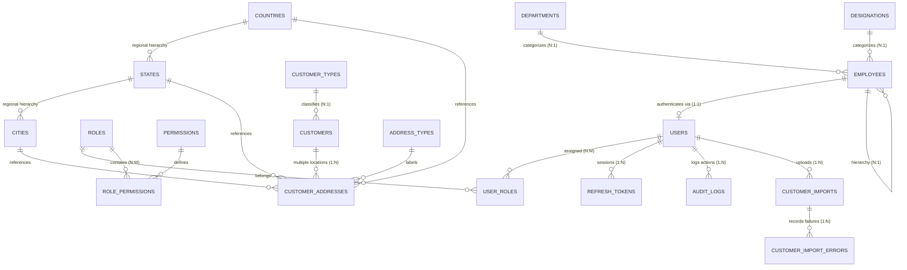
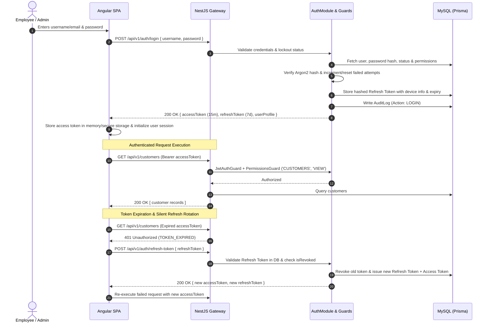

# DAMIRA by Gupta - Architecture & Technical Specification

## 1. System Architecture

DAMIRA Business Management System is designed as a **Modular Monolith** using **NestJS** on the backend and **Angular 18+ (Standalone Components)** on the frontend. This architecture ensures high cohesion within business domains, low coupling between features, and zero-friction future extraction into microservices if transaction volumes warrant it.

### Core Architectural Layers

1. **Presentation Layer (Frontend - Angular 18+ Standalone)**:
   - **UI Engine**: Angular Material with a custom Brand Palette (DAMIRA Deep Royal Purple `#5B21B6`, Vivid Purple `#7C3AED`, Slate `#0F172A`, Crisp White `#FFFFFF`, Background `#F8FAFC`).
   - **Architecture**: Standalone components, signals-powered reactive state, feature-oriented structure.
   - **Security**: Route guards (`AuthGuard`, `PermissionGuard`), HTTP interceptors for automatic JWT attachment, 401 refresh token rotation, and centralized error notification.
   - **Forms**: Strictly typed Reactive Forms with real-time validation and async validator hooks.

2. **Application & API Layer (Backend - NestJS)**:
   - **Modularity**: Domain modules (`AuthModule`, `EmployeesModule`, `UsersModule`, `RolesModule`, `CustomersModule`, `CustomerImportModule`, `MasterDataModule`, `AuditLogsModule`).
   - **Cross-Cutting Concerns**: Global `ValidationPipe` (class-validator with whitelist & transform), `HttpExceptionFilter`, `LoggingInterceptor`, `TransformInterceptor`.
   - **Security & Authorization**: Passport JWT strategy, Refresh Token rotation guard, and `@RequirePermissions({ module, action })` custom decorator enforced via `PermissionsGuard`.
   - **API Documentation**: OpenAPI / Swagger 3.0 at `/api/docs` with Bearer Auth definitions.

3. **Data Access & Persistence Layer (Prisma ORM & MySQL 8.0)**:
   - **Schema Normalization**: 3NF normalized relational schema with strict foreign key constraints.
   - **Safety**: Atomic updates via Prisma Interactive Transactions (`$transaction`).
   - **Auditing & Deletion**: Soft deletion (`is_deleted` flag) for customers, addresses, employees, and users; automated JSON change tracking in `audit_logs`.

---

## 2. Entity-Relationship (ER) Architecture



---

## 3. Authentication & Authorization Security Flow

### 3.1 Strict Internal Onboarding Flow
1. **No Public Registration**: Public sign-up routes are absent. Only authorized personnel with `EMPLOYEES:CREATE` and `USERS:MANAGE` permissions can onboard new employees.
2. **Account Linking**: Creating an employee simultaneously provisions a linked `User` record with an auto-generated cryptographically secure temporary password or sends a secure reset token.
3. **Password Security**: Passwords are hashed using **Argon2id** (memory-hard, resistant to GPU/ASIC cracking).

### 3.2 Dual-Token Authentication Lifecycle



### 3.3 Fine-Grained RBAC Model
- **Modules**: `CUSTOMERS`, `EMPLOYEES`, `USERS`, `ROLES`, `MASTER_DATA`, `AUDIT_LOGS`, `REPORTS`.
- **Actions**: `VIEW`, `CREATE`, `EDIT`, `DELETE`, `IMPORT`, `EXPORT`, `MANAGE`.
- **Resolution**: A user may have multiple roles (`Super Admin`, `Manager`, `Sales Executive`). The user's active permission set is the union of all granted permissions.

---

## 4. Customer & Multiple Address Relationship Architecture

### 4.1 Relationship & Integrity Constraints
- Every customer can have `N` addresses (Home, Office, Billing, Shipping, Warehouse).
- **Default Constraints**:
  - Exactly one address may be marked `is_default_billing = true`.
  - Exactly one address may be marked `is_default_shipping = true`.
  - Handled via atomic transactions in NestJS:
    ```typescript
    if (dto.isDefaultBilling) {
      await tx.customerAddress.updateMany({
        where: { customerId, isDefaultBilling: true },
        data: { isDefaultBilling: false },
      });
    }
    ```
- **Master Data Normalization**:
  - `countryId`, `stateId`, `cityId`, and `addressTypeId` are direct foreign keys to master data tables, avoiding misspelled cities or inconsistent state abbreviations.
- **Soft Deletion Cascade**:
  - Deleting a customer marks `is_deleted = true` on the customer record and cascades soft-deletion to linked addresses without destroying historical relational integrity.

---

## 5. Architectural Risks & Mitigation Strategies

| Risk Identified | Impact | Architectural Mitigation |
| :--- | :--- | :--- |
| **Bulk Import Resource Exhaustion** | 50,000+ rows uploaded causing Node.js OOM or MySQL connection pool lockups | Stream-based file parsing (`exceljs` streaming reader / `csv-parser`), batch processing in chunks of 500 records per transaction, asynchronous status updates. |
| **Address Default State Race Conditions** | Concurrent requests setting different addresses as default leading to dual defaults | Interactive Prisma transaction isolation (`$transaction`) with row-level locks on customer record. |
| **Indian GST & PAN Formatting Inconsistencies** | Inaccurate tax reporting or invalid business classification | Strict regex validators: GSTIN (`^[0-9]{2}[A-Z]{5}[0-9]{4}[A-Z]{1}[1-9A-Z]{1}Z[0-9A-Z]{1}$`) and PAN (`^[A-Z]{5}[0-9]{4}[A-Z]{1}$`), correlated with State master GST codes. |
| **Permission Stale Cache on Deactivation** | Deactivated employee or revoked role retains 15-minute access window | User `status` check or token versioning (`token_version`) checked during critical operations and refresh flows. |
| **Future Module Coupling (Orders, Products, Invoices)** | Changes to CRM breaking downstream e-commerce/ERP modules | Event-driven architecture hooks / Domain Service interfaces with decoupled Foreign Keys. |
